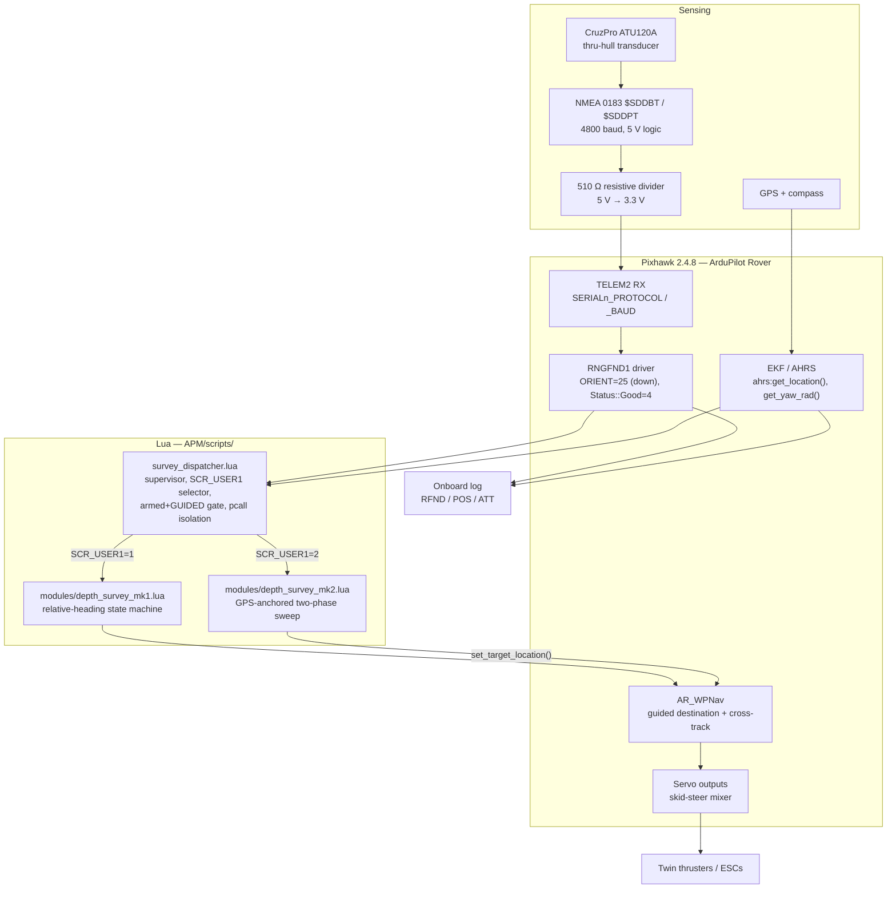

# Architecture

## Signal chain

Power is deliberately not on this diagram — it is a separate tree with a separate failure
mode. See [`../hardware/power-tree.md`](../hardware/power-tree.md).

## The pieces, and what each is responsible for

| Layer | Owns | Does **not** own |
|---|---|---|
| Transducer + divider | Producing a depth sentence at ~1 Hz at a voltage TELEM2 can read | Anything about position or timing |
| `RNGFND1` driver | Parsing, range gating (`RNGFND1_MIN`/`MAX`), status, and logging `RFND` | Deciding whether a reading is *trustworthy for survey* |
| `survey_dispatcher.lua` | Module selection, the armed+GUIDED gate, `pcall` isolation, `resume()` on re-entry | Any survey logic at all |
| `modules/*.lua` | The coverage pattern, depth triggering, edge detection, stopping | Scheduling itself, gating on mode, logging bathymetry |
| `AR_WPNav` | Driving to a commanded target, cross-track correction, pivot turns | Knowing there is a survey happening |
| Firmware logging | `RFND`, `POS`, `ATT` at full rate | Joining them — that is `analysis/extract_soundings.py`'s job |

## Two structural constraints

### Star ground is a signal-integrity constraint, not a wiring detail

The transducer's NMEA output shares a reference with the flight controller's UART. If the
signal ground and the motor return share a conductor, thruster current modulates the
reference the UART is measuring against, and depth sentences corrupt exactly when the
boat is working hardest — which is to say, during every turn. A star-ground topology,
with motor return current kept off the UART signal reference, is therefore load-bearing
for the depth data, and belongs in this document rather than only in a wiring note.
Details: [`../hardware/telem2-depth-interface.md`](../hardware/telem2-depth-interface.md).

### The dispatcher is a supervisor, and modules are inert until required

ArduPilot's scripting engine scans `APM/scripts/` **non-recursively**. Files in
`scripts/modules/` are never auto-run; they only execute when something `require()`s them.
That is what allows several complete algorithms to sit on the flight controller at once
without competing for control — and it is why `vehicle/scripts/` in this repo is a
byte-for-byte mirror of the SD card directory rather than a source tree that gets
assembled before upload. See [ADR-0005](decisions/0005-dispatcher-supervisor-pattern.md)
and [`../vehicle/DEPLOY.md`](../vehicle/DEPLOY.md).

Because a `require()`d module runs inside the dispatcher's own chunk, an uncaught error in
a module would otherwise kill the supervisor with it — leaving the boat driving to the last
Guided target with nothing left to notice. Every module entry point is therefore called
through `pcall`, and a module error commands HOLD.

## Control flow, one tick

The dispatcher ticks at 100 ms.

1. Read `SCR_USER1`. If it changed: `stop()` the outgoing module, `require`-lookup the new
   one, `init()` it — all within the single tick, so no stale command survives the switch.
2. Evaluate the gate: a module is loaded **and** `arming:is_armed()` **and**
   `vehicle:get_mode() == GUIDED`.
3. On the rising edge of that gate, call the module's `resume()` if it has one. `ModeGuided::_enter()`
   calls `wp_nav.init()` and preserves no target, so a Hold→Guided flip discards the
   destination the module thinks it set.
4. Call `update()` through `pcall`. On error: message the GCS, command HOLD, deactivate the
   module until `SCR_USER1` is toggled.

Re-entering GUIDED **resumes** the mission in progress; it does not restart it. A genuine
restart is `SCR_USER1` → 0 → back.

## Where bathymetry is recorded

Nowhere in Lua. Depth, position and attitude are logged by the firmware as `RFND`, `POS`
and `ATT` at full rate; only state transitions get a Lua write. This is a fidelity
decision and a heap decision at once — see
[ADR-0007](decisions/0007-logging-in-firmware-not-lua.md) and the `SCR_HEAP_SIZE` row in
[`../vehicle/params/verified.md`](../vehicle/params/verified.md). The join happens
afterwards on a laptop, in `analysis/extract_soundings.py`.
